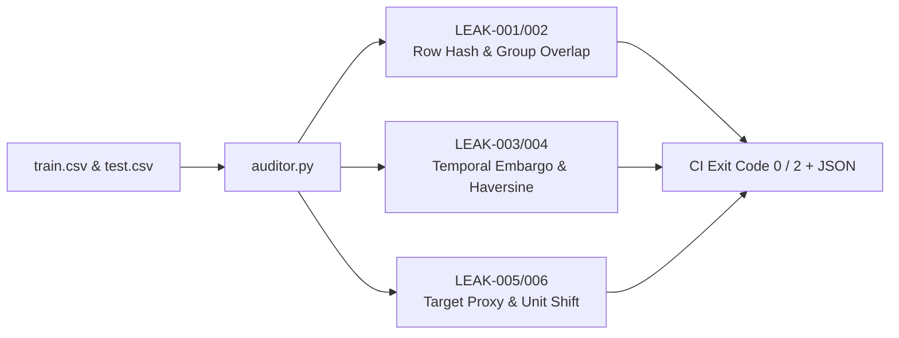

# leakguard

[](https://github.com/codesphere-u/leakguard/actions/workflows/ci.yml)
[](LICENSE)
[](pyproject.toml)
[](pyproject.toml)

**Deterministic scientific ML dataset leakage auditor: exact row duplicates, group-ID contamination, temporal look-ahead/embargo violations, Haversine spatial proximity leakage, and target-proxy detection.**

- **Mission Domain:** Scientific Research & Reproducible ML
- **Stack:** Pure Python 3.11+ (zero runtime third-party dependencies, `mypy --strict`, `ruff`, `pytest`)
- **Maintainer:** Codesphere Innovations (U) Limited (`codesphere-u`)

---

## Problem Solved

Peer-reviewed ML models in healthcare, climate, agriculture, and finance are routinely invalidated by subtle train/test leakage (shared patients/farms, shuffled timestamps, nearby spatial clusters, or post-outcome target proxies) that schema validators miss.

## Key Features

- `LEAK-001` Canonical SHA-256 exact duplicate feature row detection across train and test splits.
- `LEAK-002` Entity / Group-ID overlap detection (`patient_id`, `farm_id`, `household_id`).
- `LEAK-003` Chronological look-ahead and autocorrelation embargo window enforcement.
- `LEAK-004` Great-circle WGS84 Haversine spatial-proximity buffer verification (km).
- `LEAK-005` Pearson target-proxy correlation scan & `LEAK-006` order-of-magnitude SI/imperial unit-shift warning.

## Architecture Overview



See [docs/architecture.md](docs/architecture.md) for module-level design details.

## Installation

```bash
git clone https://github.com/codesphere-u/leakguard.git
cd leakguard
uv sync --extra dev
```

Or install in editable mode with standard `pip`:

```bash
pip install -e ".[dev]"
```

## Quick Start (CLI)

```bash
leakguard audit train.csv test.csv --target outcome --group patient_id --time ts --lat lat --lon lon --embargo-hours 24
```

## Quick Start (Python API)

```python
from leakguard import audit_split

rep = audit_split([{"id": "A", "x": 1, "y": 0}], [{"id": "A", "x": 1, "y": 0}], group_col="id", target_col="y")
assert not rep.passed
```

## Testing & Quality Gates

```bash
uv run ruff check src tests
uv run mypy src
uv run pytest -v
```

## Security, Contributing & Roadmap

- **Security:** See [SECURITY.md](SECURITY.md) for responsible disclosure procedures.
- **Contributing:** See [CONTRIBUTING.md](CONTRIBUTING.md) and [CODE_OF_CONDUCT.md](CODE_OF_CONDUCT.md).
- **Changelog & Roadmap:** See [CHANGELOG.md](CHANGELOG.md) and [ROADMAP.md](ROADMAP.md).

## License

MIT License — see [LICENSE](LICENSE).

## Support & Contact

Open an issue on [GitHub Issues](https://github.com/codesphere-u/leakguard/issues) or contact `codesphereinnovationz@gmail.com`.
